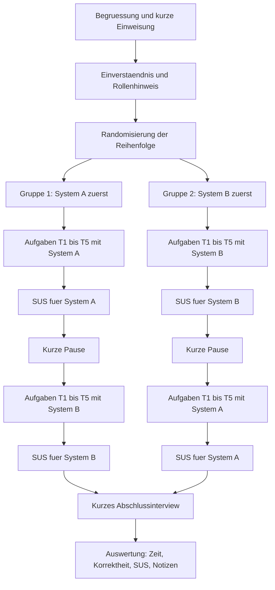

# Meilenstein 4: Empirische Evaluation von SeniorCare+

Dieses Dokument beschreibt eine konkrete, direkt durchfuehrbare Loesung fuer den Meilenstein 4 im Praktikum Human-Computer-Interaction SoSe 2026.  
Ziel ist eine **formative Evaluation** von SeniorCare+, also eine Evaluation waehrend der Entwicklungsphase, um Staerken, Schwaechen und Verbesserungsmoeglichkeiten zu erkennen.

SeniorCare+ ist eine React/Vite App mit Supabase-Anbindung. Die App unterstuetzt Seniorinnen und Senioren sowie Caregiver bei Login, Medikamenten, Terminen, Uebungen, SOS und der Verbindung ueber einen Senior-Code.

> Hinweis: Alle Ergebniszahlen in diesem Dokument sind nur **fiktive Beispiele**. Sie duerfen nicht als echte Evaluationsergebnisse verwendet werden.

## 1. Planung der Evaluation

### 1.1 Evaluierte Aspekte

In der Evaluation werden drei Hauptaspekte untersucht:

| Aspekt | Bedeutung fuer SeniorCare+ | Messung |
|---|---|---|
| **Usability** | Wie einfach, verstaendlich und angenehm ist die Bedienung fuer Seniorinnen/Senioren und Caregiver? | SUS-Fragebogen nach jeder Systemvariante |
| **Task-Completion-Time** | Wie lange brauchen ProbandInnen fuer typische Aufgaben? | Zeit in Sekunden pro Aufgabe |
| **Task-Completion-Correctness** | Werden Aufgaben korrekt und ohne Hilfe abgeschlossen? | korrekt / teilweise korrekt / nicht korrekt |

Optional koennen zusaetzlich Klicks, Fehlklicks und Hilferufe notiert werden. Diese Zusatzdaten helfen bei der Interpretation, sind aber nicht die Hauptmetriken.

### 1.2 Standardisierter Fragebogen: SUS

Als standardisierter Fragebogen wird die **System Usability Scale (SUS)** verwendet.

**Begruendung:**

- SUS ist kurz und fuer kleine Stichproben gut geeignet.
- Der Fragebogen misst die wahrgenommene Usability mit einem Wert von 0 bis 100.
- SUS ist einfacher auszuwerten als umfangreichere Frageboegen wie AttrakDiff.
- Fuer SeniorCare+ passt SUS gut, weil die App vor allem effizient, verstaendlich und sicher bedienbar sein soll.

**Durchfuehrung:**

- Nach jeder getesteten Systemvariante fuellt die Testperson den SUS-Fragebogen aus.
- Die Antworten werden auf einer 5-stufigen Likert-Skala erfasst.
- Fuer jede Systemvariante wird ein SUS-Score berechnet.

### 1.3 Hypothesen

Verglichen werden zwei Systeme:

- **System A:** SeniorCare+ aktuelle Version.
- **System B:** SeniorCare+ reduzierte Vergleichsversion.

Die Hypothesen werden bewusst konkret auf SeniorCare+ bezogen.

**Nullhypothese (H0):**

Zwischen der aktuellen Version von SeniorCare+ und der reduzierten Vergleichsversion gibt es keinen signifikanten Unterschied in Bezug auf Usability, Task-Completion-Time und Task-Completion-Correctness.

Formal:

- H0.1: Der mittlere SUS-Score von System A ist gleich dem mittleren SUS-Score von System B.
- H0.2: Die mittlere Bearbeitungszeit fuer Aufgaben ist bei System A gleich der mittleren Bearbeitungszeit bei System B.
- H0.3: Der Anteil korrekt geloester Aufgaben ist bei System A gleich dem Anteil korrekt geloester Aufgaben bei System B.

**Alternativhypothese (H1):**

Die aktuelle Version von SeniorCare+ ist besser als die reduzierte Vergleichsversion.

Formal:

- H1.1: System A erreicht einen hoeheren mittleren SUS-Score als System B.
- H1.2: ProbandInnen benoetigen mit System A weniger Zeit fuer die Aufgaben als mit System B.
- H1.3: ProbandInnen loesen mit System A mehr Aufgaben korrekt als mit System B.

### 1.4 Vergleichssystem

Als Vergleichssystem wird eine **reduzierte Version von SeniorCare+** verwendet, nicht ein reines Text- oder Bild-Pseudosystem.

**Begruendung:**

Ein reines Pseudosystem aus Text oder Bildern waere fuer SeniorCare+ nur eingeschraenkt geeignet, weil viele Aufgaben echte Interaktion brauchen:

- Login mit Rolle Senior/Caregiver
- Medikament hinzufuegen
- Termin ansehen
- Senior-Code eingeben
- SOS starten oder abbrechen

Die reduzierte Version kann dieselben Aufgaben ermoeglichen, aber mit weniger HCI-Unterstuetzung.

**System B: SeniorCare+ reduzierte Vergleichsversion**

Diese Variante sollte fuer die Evaluation folgende Eigenschaften haben:

- gleiche Daten und gleiche Aufgaben wie System A
- einfache textbasierte Navigation statt Bottom Navigation mit klaren Bereichen
- weniger visuelles Feedback nach Speichern oder Loeschen
- keine starke farbliche Hervorhebung von Statuszustaenden
- keine automatische Scrollhilfe zum Bearbeitungsformular
- SOS-Bereich weniger klar getrennt von der Notiz

**Wichtig:** System B muss die Aufgaben trotzdem loesbar machen. Es darf nicht absichtlich kaputt sein, sondern nur weniger gut gestaltet.

Praktische Umsetzung:

- Variante B kann als separater Branch, lokaler Modus oder einfache alternative Route umgesetzt werden.
- Beispiel: `/evaluation/reduced`
- Wenn keine zweite Implementierung gebaut wird, kann Variante B als klickbarer Low-Fidelity-Prototyp mit denselben Screens umgesetzt werden.

### 1.5 Teilnehmerzahl und Randomisierung

Fuer den Meilenstein reicht eine kleine Stichprobe. Geplant werden:

- **6 ProbandInnen**, falls moeglich
- Mindestumfang: **5 ProbandInnen**, wie im Aufgabenblatt erwaehnt

Die ProbandInnen sollen keine EntwicklerInnen der App sein. Ideal waeren:

- 3 Personen, die die Senior-Rolle testen
- 3 Personen, die die Caregiver-Rolle testen

Wenn nur 5 Personen verfuegbar sind:

- 3 Personen testen zuerst System A, dann System B
- 2 Personen testen zuerst System B, dann System A

**Randomisierung:**

Da ein **within-subject-design** verwendet wird, testen alle Personen beide Systeme. Die Reihenfolge wird randomisiert:

| Gruppe | Reihenfolge |
|---|---|
| Gruppe 1 | System A -> System B |
| Gruppe 2 | System B -> System A |

Zuteilung:

- Namen der ProbandInnen auf Zettel schreiben oder mit Zufallszahl sortieren.
- Erste Haelfte bekommt Reihenfolge A-B.
- Zweite Haelfte bekommt Reihenfolge B-A.

So werden Lerneffekte reduziert, weil nicht alle Personen mit demselben System starten.

### 1.6 Konkrete Aufgaben

Die Aufgaben basieren auf echten Funktionen von SeniorCare+.

Jede Aufgabe wird fuer beide Systeme gleich formuliert.

| Nr. | Rolle | Aufgabe | Erfolgskriterium |
|---|---|---|---|
| T1 | Senior | Melde dich als Senior an und oeffne die Startseite. | Senior-Dashboard ist sichtbar. |
| T2 | Senior | Fuege ein neues Medikament hinzu: Name "Vitamin D", Menge "1", Einheit "Tablette", Uhrzeit "09:00". | Medikament erscheint in der Medikamentenliste. |
| T3 | Senior | Finde den naechsten Termin und nenne Uhrzeit und Ort. | Uhrzeit und Adresse werden korrekt genannt. |
| T4 | Senior | Starte den SOS-Notruf und brich ihn vor dem Senden wieder ab. | Countdown startet und wird korrekt abgebrochen. |
| T5 | Caregiver | Melde dich als Caregiver an, gib den Senior-Code ein und oeffne die Detailseite des Seniors. | Senior ist verbunden und Detailseite ist sichtbar. |

Falls die Evaluation zu lange dauert, kann T4 optional gestrichen werden. Dann bleiben T1, T2, T3 und T5.

### 1.7 Studiendesign

Es wird ein **within-subject-design** verwendet.

**Begruendung:**

- Bei kleiner Teilnehmerzahl ist within-subject besser geeignet, weil jede Person beide Systeme bewertet.
- Unterschiede zwischen Personen fallen weniger stark ins Gewicht.
- Fuer Meilenstein 4 ist der Prozess wichtiger als eine grosse Stichprobe.
- SUS, Zeit und Korrektheit koennen direkt pro Person zwischen System A und System B verglichen werden.

**Risiko:** Lerneffekte.  
**Massnahme:** Reihenfolge randomisieren und fuer Aufgaben leicht unterschiedliche Beispieldaten verwenden.

Beispiel:

- In System A Medikament "Vitamin D" hinzufuegen.
- In System B Medikament "Magnesium" hinzufuegen.

Die Aufgabe bleibt gleich schwer, aber die Person wiederholt nicht exakt denselben Text.

### 1.8 Ablaufdiagramm

## 2. Durchfuehrung und Auswertung

### 2.1 Testprotokoll

Jede Testsitzung dauert ca. 30 bis 45 Minuten.

**Vorbereitung:**

1. Testgeraet vorbereiten.
2. Browsercache optional leeren.
3. Beide Systeme bereitstellen:
   - System A: aktuelle SeniorCare+ Version
   - System B: reduzierte Vergleichsversion
4. Testdaten vorbereiten:
   - Senior-Konto
   - Caregiver-Konto
   - Senior-Code
   - Beispieltermine
   - Beispielmedikamente
5. Tabellenblatt fuer Messwerte vorbereiten.
6. SUS-Fragebogen fuer beide Systeme vorbereiten.

**Einweisung fuer ProbandInnen:**

Der folgende Text kann vorgelesen werden:

> "Wir testen nicht Sie, sondern die Anwendung. Bitte bearbeiten Sie die Aufgaben so, wie Sie es normalerweise tun wuerden. Wenn etwas unklar ist, sagen Sie es laut. Ich helfe nur, wenn Sie gar nicht weiterkommen. Die Zeit wird gemessen, damit wir die Systeme vergleichen koennen."

**Was wird gemessen?**

| Datentyp | Messung | Methode |
|---|---|---|
| Task-Completion-Time | Sekunden pro Aufgabe | Stoppuhr ab Aufgabenstart bis Erfolg oder Abbruch |
| Task-Completion-Correctness | korrekt / teilweise / falsch | BeobachterIn bewertet nach Erfolgskriterium |
| SUS | Score 0 bis 100 | SUS-Fragebogen nach jeder Systemvariante |
| Klicks optional | Anzahl Klicks pro Aufgabe | manuell mitzaehlen oder Screen Recording |
| Hilfen optional | Anzahl Eingriffe durch Testleitung | Strichliste |
| qualitative Notizen | Probleme, Zitate, Verwirrung | Beobachtungsnotizen |

**Bewertung der Korrektheit:**

| Wert | Bedeutung |
|---|---|
| 1 | Aufgabe korrekt ohne Hilfe abgeschlossen |
| 0.5 | Aufgabe mit kleiner Hilfe oder Umweg abgeschlossen |
| 0 | Aufgabe nicht korrekt abgeschlossen oder abgebrochen |

Fuer Chi-Square kann die Bewertung spaeter vereinfacht werden:

- korrekt = 1
- nicht korrekt = 0
- teilweise korrekt kann entweder ausgeschlossen oder als nicht korrekt gezaehlt werden; die Entscheidung muss im Bericht erwaehnt werden.

### 2.2 Datenerfassungstabelle

Diese Tabelle kann direkt als Vorlage genutzt werden.

| VP | Rolle | Reihenfolge | System | Aufgabe | Zeit in s | Korrektheit | Klicks optional | Hilfe optional | Notiz |
|---|---|---|---|---|---:|---:|---:|---:|---|
| VP01 | Senior | A-B | A | T1 Login | 42 | 1 | 5 | 0 | fand Login schnell |
| VP01 | Senior | A-B | A | T2 Medikament | 95 | 1 | 9 | 0 | Uhrzeitfeld verstanden |
| VP01 | Senior | A-B | B | T2 Medikament | 134 | 0.5 | 14 | 1 | suchte Speichern-Button |

### 2.3 Statistische Tests

Das Signifikanzniveau wird vorher festgelegt:

- **alpha = 0.05**

#### t-Test

Der **t-Test** wird fuer metrische Daten verwendet.

In dieser Evaluation betrifft das:

- SUS-Score
- Task-Completion-Time
- optional Anzahl Klicks

Da alle ProbandInnen beide Systeme testen, wird ein **gepaarter t-Test** verwendet.

Beispiele:

- Vergleich SUS System A vs. SUS System B
- Vergleich durchschnittliche Zeit System A vs. System B
- Vergleich Zeit fuer Aufgabe T2 in System A vs. System B

**Interpretation:**

- p < 0.05: Unterschied ist statistisch signifikant.
- p >= 0.05: Kein signifikanter Unterschied nachweisbar.

Wenn die Daten stark schief verteilt sind oder viele Ausreisser enthalten, kann im Bericht erwaehnt werden, dass wegen kleiner Stichprobe vorsichtig interpretiert wird. Fuer den Praktikumsbericht reicht aber ein t-Test als nachvollziehbares Verfahren.

#### Chi-Square Test

Der **Chi-Square Test** wird fuer kategoriale Daten verwendet.

In dieser Evaluation betrifft das:

- Aufgabe korrekt geloest: ja/nein
- System A vs. System B

Beispiel:

| System | korrekt | nicht korrekt |
|---|---:|---:|
| System A | 25 | 5 |
| System B | 18 | 12 |

Der Chi-Square Test prueft, ob die Verteilung von korrekt/nicht korrekt zwischen den Systemen unterschiedlich ist.

**Hinweis fuer kleine Stichprobe:**

Bei sehr wenigen Personen koennen die erwarteten Haeufigkeiten klein sein. Dann sollte das Ergebnis vorsichtig interpretiert werden. Fuer den Meilenstein ist wichtig, dass der Test passend begruendet wird.

#### Wann welcher Test?

| Datenart | Beispiel | Test |
|---|---|---|
| metrisch | SUS-Score, Zeit in Sekunden | gepaarter t-Test |
| kategorial | korrekt / nicht korrekt | Chi-Square Test |
| mehrere Aufgabenzeiten | durchschnittliche Zeit pro System | gepaarter t-Test |
| Erfolgsraten | Anzahl korrekter Aufgaben pro System | Chi-Square Test |

### 2.4 Fiktives Beispiel fuer Ergebnisstruktur

Die folgende Tabelle ist **nur ein fiktives Beispiel**. Sie zeigt, wie die Ergebnisse spaeter dargestellt werden koennen.

| Metrik | System A: SeniorCare+ aktuell | System B: reduziert | Test | p-Wert | Interpretation |
|---|---:|---:|---|---:|---|
| SUS Mittelwert | 82.5 | 67.0 | gepaarter t-Test | 0.032 | Beispiel: System A waere signifikant besser |
| Durchschnittliche Zeit pro Aufgabe | 78 s | 105 s | gepaarter t-Test | 0.041 | Beispiel: System A waere schneller |
| Korrekt geloeste Aufgaben | 27/30 | 21/30 | Chi-Square Test | 0.048 | Beispiel: System A haette mehr korrekte Loesungen |
| Durchschnittliche Klicks | 7.2 | 10.4 | gepaarter t-Test | 0.060 | Beispiel: Tendenz, aber nicht signifikant |

Wichtig:

- Diese Werte sind nicht real.
- Im echten Bericht muessen die gemessenen Werte eingetragen werden.
- Wenn p >= 0.05 ist, darf kein signifikanter Unterschied behauptet werden.

### 2.5 Beispiel fuer Aufgaben-Auswertung

Auch diese Tabelle ist **fiktiv**.

| Aufgabe | System A Zeit Mittelwert | System B Zeit Mittelwert | System A korrekt | System B korrekt | Beobachtung |
|---|---:|---:|---:|---:|---|
| T1 Login | 38 s | 52 s | 6/6 | 5/6 | reduzierte Version hatte unklare Rollenwahl |
| T2 Medikament | 92 s | 130 s | 5/6 | 4/6 | Speichern wurde in B schlechter gefunden |
| T3 Termin finden | 45 s | 66 s | 6/6 | 5/6 | Bottom Navigation half in A |
| T4 SOS abbrechen | 31 s | 55 s | 6/6 | 3/6 | Countdown und Abbrechen waren in A klarer |
| T5 Senior verbinden | 110 s | 148 s | 4/6 | 3/6 | Senior-Code blieb schwierig |

### 2.6 Struktur des finalen Evaluationsberichts

Der finale Bericht fuer Meilenstein 4 kann so aufgebaut werden:

1. **Einleitung**
   - Kurzbeschreibung SeniorCare+
   - Ziel der formativen Evaluation
   - Vergleich von aktueller Version und reduzierter Version

2. **Evaluationsplanung**
   - Evaluierte Aspekte
   - SUS als Fragebogen
   - Hypothesen H0 und H1
   - Beschreibung der Systeme A und B
   - TeilnehmerInnen und Randomisierung
   - Aufgabenliste
   - Studiendesign
   - Ablaufdiagramm

3. **Durchfuehrung**
   - Testumgebung
   - Ablauf pro Person
   - Erhobene Daten
   - Hinweise zu Rollen Senior/Caregiver

4. **Auswertung**
   - Deskriptive Statistik:
     - Mittelwerte
     - Standardabweichungen
     - Erfolgsraten
   - SUS-Auswertung
   - t-Test fuer Zeit und SUS
   - Chi-Square Test fuer Korrektheit
   - Signifikanzniveau alpha = 0.05

5. **Ergebnisse**
   - Tabellen mit realen Werten
   - Diagramme, z.B. Balkendiagramme fuer SUS und Zeit
   - Kurze Interpretation

6. **Diskussion**
   - Was lief gut?
   - Wo gab es Probleme?
   - Welche Einschraenkungen hat die Evaluation?
   - Kleine Stichprobe beachten

7. **Handlungsempfehlungen**
   - konkrete Verbesserungen fuer SeniorCare+

8. **Anhang**
   - Aufgabenblaetter
   - SUS-Fragebogen
   - Rohdaten
   - Einverstaendniserklaerung, falls genutzt

### 2.7 Konkrete Handlungsempfehlungen als Bonus

Diese Empfehlungen sind typische Beispiele. Sie muessen nach der echten Evaluation an die beobachteten Probleme angepasst werden.

| Beobachtetes Problem | Moegliche Verbesserung in SeniorCare+ |
|---|---|
| Senior findet Speichern-Button nicht schnell genug | Button visuell staerker hervorheben oder direkt unter dem letzten Eingabefeld platzieren |
| Senior-Code wird falsch eingegeben | Code-Eingabe mit automatischen Leerstellen, klarer Fehlermeldung und Beispiel anzeigen |
| SOS-Abbrechen wird uebersehen | Abbrechen-Button groesser machen und Countdown-Farbe klarer anzeigen |
| Caregiver versteht Status "kritisch" nicht sofort | Status mit kurzem Zusatztext oder Icon ergaenzen |
| Bearbeiten-Formular wird nach Klick nicht bemerkt | Automatisches Scrollen beibehalten und Formular kurz visuell markieren |
| Navigation zwischen Medikamente/Termine/Uebungen dauert zu lange | Tabs oder Bottom Navigation sichtbarer und konsistenter gestalten |

### 2.8 Checkliste fuer die echte Durchfuehrung

Vor dem Test:

- [ ] System A laeuft lokal oder auf Testgeraet.
- [ ] System B ist vorbereitet.
- [ ] Testkonten sind angelegt.
- [ ] Senior-Code ist bekannt.
- [ ] Aufgabenblatt ist gedruckt oder als PDF bereit.
- [ ] SUS-Fragebogen ist bereit.
- [ ] Tabelle fuer Messwerte ist vorbereitet.
- [ ] Reihenfolge A-B oder B-A ist randomisiert.

Waehrend des Tests:

- [ ] Startzeit jeder Aufgabe notieren.
- [ ] Endzeit jeder Aufgabe notieren.
- [ ] Korrektheit bewerten.
- [ ] Hilfen und Probleme notieren.
- [ ] Nach jedem System SUS ausfuellen lassen.

Nach dem Test:

- [ ] Zeiten berechnen.
- [ ] SUS-Scores berechnen.
- [ ] Erfolgsraten berechnen.
- [ ] t-Test fuer SUS und Zeit durchfuehren.
- [ ] Chi-Square Test fuer Korrektheit durchfuehren.
- [ ] Ergebnisse mit alpha = 0.05 interpretieren.
- [ ] Handlungsempfehlungen aus den Beobachtungen ableiten.

